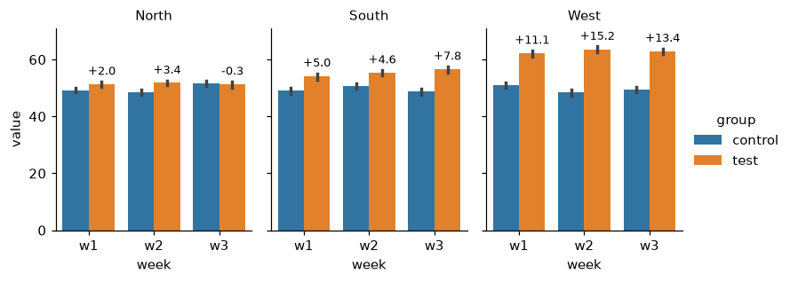

# mcrotk-utils

Helpers for data analysis and simulation in Python: general utilities, `numpy` and `pandas` helpers, sparse matrices, statistics, and plotting, one module per topic. Each module needs only its own third-party dependencies, the code is fully typed (checked with pyright and mypy), and the tests compare results with `numpy`, `scipy`, and `statsmodels` wherever those compute the same thing.

## Highlights

These are the functions most worth a look, each linked to its examples:

- [`label_bars`](src/mcrotk_utils/plotting_utils/README.md#a-grid-of-plots) labels the bars of a plot drawn by `matplotlib`, `pandas`, or `seaborn` with their values, their shares of a total, or their changes from other bars (week over week, or test against control), keeping the labels clear of error bars. One call labels a whole grid of plots, with one number format across all of them:

  <p align="center">
    
  </p>

- [`bisect_to_target`](src/mcrotk_utils/misc_utils/README.md#bisection-over-integers) finds where a monotonic function crosses a target value. Unlike `scipy`'s root finders, it can stop once the function's values are close enough, carry an expensive result (such as a fitted model) along so nothing is recomputed, return the points on both sides of the target, and search over integers, e.g. for the smallest sample size giving a test enough power.
- [`sort_with_directions`](src/mcrotk_utils/misc_utils/README.md#sorting-in-different-directions) sorts by several keys, each ascending or descending on its own, for keys of any type, such as dates or strings, which can't be negated to reverse them.
- [`parallel_map_with_rngs`](src/mcrotk_utils/multiprocessing_utils/README.md#a-parallel-map-with-random-generators) runs a function in parallel, giving each call its own random generator spawned from one seed, so that the results don't depend on the number of workers or on how the calls are split among them.
- [`merge_with_preferences`](src/mcrotk_utils/pandas_utils/README.md#merge_with_preferences) merges two DataFrames on their indexes, turning each pair of shared columns you choose into a single column: rows in both DataFrames take the value from the side you prefer for that column, and rows in only one take that one's value.
- [`p_value_from_empirical_dist`](src/mcrotk_utils/stats_utils/README.md#a-permutation-test) gives the p-value of an observed statistic from an empirical null distribution, such as the statistic recomputed under random re-assignments in a permutation test, for one- or two-sided alternatives.

## Modules

The package has one module per topic, each with its own README listing what it contains, with examples. Each module's third-party dependencies come with an extra of the same name. Import from the module itself (e.g. `from mcrotk_utils.plotting_utils import label_bars`); the package's `__init__.py` imports nothing, so a project only needs the extras for the modules it uses.

| Module | Requires | Description |
|---|---|---|
| [`misc_utils`](src/mcrotk_utils/misc_utils/README.md) | nothing | Checks, formatting, mappings, atomic file writes, sorting by keys in different directions, and bisection to a target value |
| [`multiprocessing_utils`](src/mcrotk_utils/multiprocessing_utils/README.md) | `numpy`, for the parallel map only | A parallel map giving each call its own random generator, and splitting work among workers |
| [`numpy_utils`](src/mcrotk_utils/numpy_utils/README.md) | `numpy` | Interleaving arrays, comparing entries along an axis, and type aliases for arrays and seeds |
| [`pandas_utils`](src/mcrotk_utils/pandas_utils/README.md) | `pandas` | Making, concatenating, merging, and adding to DataFrames, and dtypes for their columns |
| [`plotting_utils`](src/mcrotk_utils/plotting_utils/README.md) | `matplotlib` | Labelling bars with their values, shares, or comparisons with other bars |
| [`sparse_utils`](src/mcrotk_utils/sparse_utils/README.md) | `scipy` | Converting and stacking matrices that may be dense or sparse |
| [`stats_utils`](src/mcrotk_utils/stats_utils/README.md) | `scipy`, or `numpy` for some | Weighted means, p-values and confidence intervals, and random covariance matrices |

## Installation

The package needs Python 3.12 or later. It isn't published on PyPI, so it's installed from GitHub, with the extras for the modules you'll use. With pip, for a tagged version:

```sh
pip install "mcrotk-utils[numpy,pandas] @ git+https://github.com/mcrotk/mcrotk_utils@v0.6.0"
```

The repository's [tags](https://github.com/mcrotk/mcrotk_utils/tags) list the versions; in a clone, `git tag -l -n99` also shows what each version adds.

A project managed with uv lists the package with its extras, and says where to get it in `[tool.uv.sources]`. There are three options: a tagged version, the latest commit, or a local checkout as an editable install.

```toml
[project]
dependencies = [
    "mcrotk-utils[numpy,pandas,scipy,matplotlib]",
]

[tool.uv.sources]
# one of:
mcrotk-utils = { git = "https://github.com/mcrotk/mcrotk_utils", tag = "v0.6.0" }  # a tagged version
# mcrotk-utils = { git = "https://github.com/mcrotk/mcrotk_utils" }  # the latest commit on the default branch
# mcrotk-utils = { path = "../mcrotk_utils", editable = true }  # a local checkout, relative to the project
```

The options differ in when the project picks up changes:

- **A tagged version:** the project stays on that version until the tag is changed.
- **The latest commit:** `uv lock` records the commit that was latest at the time in the project's `uv.lock`, and the project stays on it until `uv lock --upgrade-package mcrotk-utils` moves it to the latest again. This includes changes made since the last tagged version.
- **A local checkout:** changes in the checkout show up immediately.

uv can write these entries for you. `uv add "mcrotk-utils[numpy] @ git+https://github.com/mcrotk/mcrotk_utils" --tag v0.6.0` writes the first form, and leaving out `--tag` writes the second. `uv add --editable <path to the checkout> --extra numpy` writes the third. More extras can be listed as `[numpy,pandas]`, or with more `--extra` options.

## Scope and stability

The package is shared as it is, without promises of stability: its interfaces can change between versions, so a project that depends on it may want to pin a tagged version.

When part of the package grows big and general enough to publish on its own, it moves out into its own package and is deleted from here, as the caching code did with [`mcrotk-cache-utils`](https://pypi.org/project/mcrotk-cache-utils/). Packages that have moved out aren't re-exported from here, so they're imported under their own names.

A project that will be published on PyPI can't depend on this package, since PyPI rejects dependencies on git repositories and local paths. Such a project copies the few helpers it needs into its own code instead.

## License

Released under the MIT License; see [LICENSE](LICENSE) for the full text.

## Development

The checks are run locally (there's no CI), with the development dependencies that uv installs:

```sh
uv run pytest
uv run ruff check .
uv run ruff format --check .
uv run pyright
uv run mypy
```

There are about 2,000 tests. Besides running on the latest versions of the dependencies, they're run on the oldest versions the extras allow: Python 3.12, `numpy` 1.26.0, `pandas` 2.1.1, `scipy` 1.13.0, and `matplotlib` 3.7.3.

The tests include each module's README: its examples are run, and every public name must be listed in it. The images in the READMEs are drawn from the examples shown with them; after changing one of those examples, redraw the images with `uv run python scripts/make_readme_images.py`.
