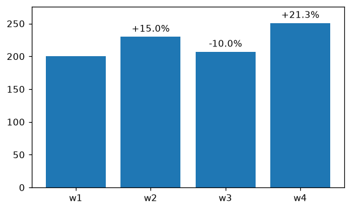
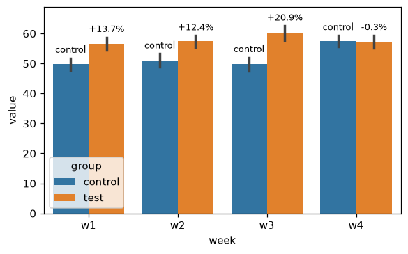
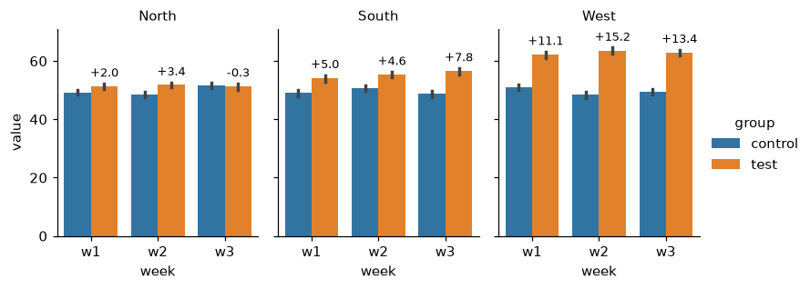
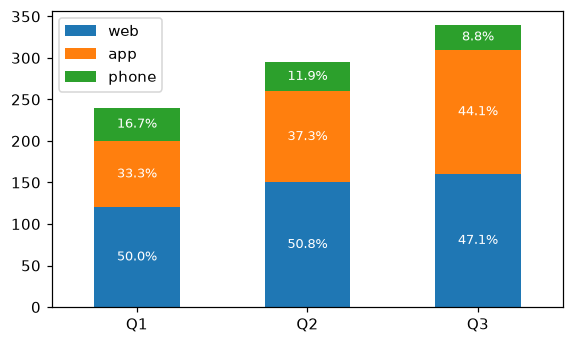
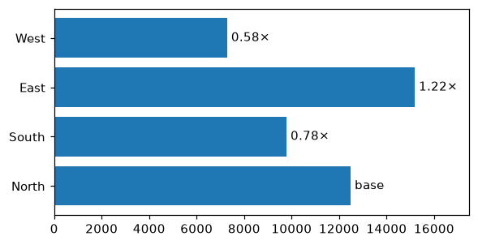

# `mcrotk_utils.plotting_utils`

Helpers for `matplotlib` plots, for now one: labelling bars with their values, their shares of a total, or comparisons with other bars. It needs `matplotlib` (`mcrotk-utils[matplotlib]`, which brings `numpy`), and works on bar plots drawn by `matplotlib`, `pandas`, or `seaborn`. The docstring of `label_bars` has the details: its arguments, result, and errors.

[Back to the package README](../../../README.md)

## Contents

The module has one function, and type aliases for its arguments.

- `label_bars`: label each bar on an axes with its value, its share of a total, or its difference, relative change, or ratio from a reference bar. The bars form a table of categories (such as weeks) by series (such as test and control groups), and comparisons go either along the categories (e.g. week over week, within each series) or across the series (e.g. test against control, within each week). The reference bar can be the previous, next, first, or last one, one at an index, or a category or series given by name. Labels go outside the bars (kept clear of error bars), inside them, or at their middle, with formats chosen to suit the measure unless one is given. A grid of plots (such as one from `seaborn`'s `catplot`) can be labelled in one call, with one format across all its subplots.
- `BarLabelMeasure`, `BarLabelReference`, and `BarLabelPosition`: the types of the `measure`, `reference`, and `position` arguments of `label_bars`.

## Examples

These examples show the main ways of labelling bars, each with the plot it draws. (The images are drawn from this code by `scripts/make_readme_images.py`.)

### Week over week

Each week's relative change from the week before, on bars drawn with `matplotlib`. The first week has nothing to compare with, so it has no label:

```python
import matplotlib.pyplot as plt
import numpy as np
import pandas as pd
import seaborn as sns

from mcrotk_utils.plotting_utils import label_bars

fig, ax = plt.subplots(figsize=(6, 3.5))
ax.bar(["w1", "w2", "w3", "w4"], [200, 230, 207, 251])
label_bars(ax, "relative")
ax.margins(y=0.1)
```



### Test against control

Each test bar's relative change from the control bar in the same week, on bars drawn by `seaborn` from individual orders, with error bars of one standard error. The labels go above the error bars, and the control bars are labelled "control":

```python
rng = np.random.default_rng(0)
weeks = np.repeat(["w1", "w2", "w3", "w4"], 100)
groups = np.tile(["control", "test"], 200)
values = rng.normal(50, 15, size=400) + np.repeat([0, 3, 5, 6], 100) + np.where(groups == "test", 4, 0)
orders = pd.DataFrame({"week": weeks, "group": groups, "value": values})
fig, ax = plt.subplots(figsize=(6, 3.5))
sns.barplot(data=orders, x="week", y="value", hue="group", errorbar="se", ax=ax)
label_bars(ax, "relative", "control", along="series", reference_label="control", fontsize="small")
ax.margins(y=0.1)
```



### A grid of plots

The test group's difference from control in each week, for each region, on a grid drawn by `seaborn`'s `catplot`. One call labels every subplot, comparing bars within each, and the default format is chosen from all of them, so every label has one decimal (labelled on its own, the North would get two):

```python
rng = np.random.default_rng(1)
orders = pd.MultiIndex.from_product(
    [["North", "South", "West"], ["w1", "w2", "w3"], ["control", "test"], range(100)],
    names=["region", "week", "group", "order"],
).to_frame(index=False)
lift = orders["region"].map({"North": 2, "South": 6, "West": 12})
orders["value"] = rng.normal(50, 10, size=len(orders)) + np.where(orders["group"] == "test", lift, 0)
grid = sns.catplot(
    data=orders, x="week", y="value", hue="group", col="region", kind="bar", errorbar="se", height=3, aspect=0.8
)
label_bars(grid, "difference", "control", along="series", fontsize="small")
grid.set(ymargin=0.1)
grid.set_titles("{col_name}")
```



### Shares of a stacked bar

Each part's share of its quarter's total, on stacked bars drawn by `pandas`, with the labels at the middle of each part:

```python
sales = pd.DataFrame(
    {"web": [120, 150, 160], "app": [80, 110, 150], "phone": [40, 35, 30]},
    index=["Q1", "Q2", "Q3"],
)
ax = sales.plot.bar(stacked=True, rot=0, figsize=(6, 3.5))
label_bars(ax, "share", along="series", position="center", color="white", fontsize="small")
```



### Ratios to a named bar

Each region's sales as a ratio to the North's, on horizontal bars, with the reference bar named by its tick label:

```python
fig, ax = plt.subplots(figsize=(6, 3))
ax.barh(["North", "South", "East", "West"], [12500, 9800, 15200, 7300])
label_bars(ax, "ratio", "North", reference_label="base")
ax.margins(x=0.15)
```



### What it returns

`label_bars` returns the labels it added, one list per series (here, the control and test groups' bars drawn by `pandas`), so they can be adjusted afterwards:

```pycon
>>> import matplotlib.pyplot as plt
>>> import pandas as pd
>>> from mcrotk_utils.plotting_utils import label_bars
>>> orders = pd.DataFrame({"control": [100, 120], "test": [110, 126]}, index=["w1", "w2"])
>>> ax = orders.plot.bar()
>>> labels = label_bars(ax, "relative", "control", along="series", reference_label="base")
>>> [[label.get_text() for label in series] for series in labels]
[['base', 'base'], ['+10.0%', '+5.0%']]
>>> plt.close(ax.figure)
```
